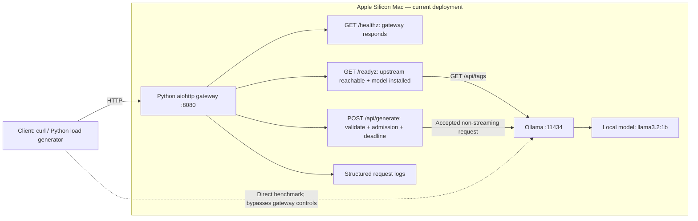

# AI Inference Reliability Platform

A customer-oriented inference engineering project: turn serving requirements into
measured capacity, explain failures, and validate improvements with repeatable experiments.
The focus is inference behavior and operational evidence, building on existing DevOps,
Kubernetes, CI/CD, AWS, and on-premises experience.

## Customer engagement

A fictional internal AI assistant serves single requests successfully. Before adding users,
the customer needs a latency/throughput baseline, visible failures, and a defensible scaling
plan. No production SLO or target arrival rate has been supplied; experiments characterize
the system rather than declare it production-ready.

## Current implementation

**Milestone 1: reproducible Ollama baseline and bounded concurrency experiment.**

- Local HTTP inference on Apple Silicon; no CUDA assumptions or cloud resources.
- Explicit model-residency Cold/Warm pairs; fixed prompt and generation options.
- Concurrency 1/2/4, 12 requests per run, three repetitions, retries disabled.
- Request-level evidence, server timing fields, version/model/environment snapshots,
  per-run statistics, offline reanalysis, and standard-library automated tests.
- [Experiment guide](labs/01-ollama/README.md), [methodology](labs/01-ollama/docs/methodology.md),
  [analysis](labs/01-ollama/docs/analysis.md), and [customer PoC report](labs/01-ollama/docs/poc-report.md).

**Milestone 2 is in progress:** [gateway design and engineering insights](labs/02-gateway/README.md).
Forwarding, error handling, admission rejection, and recovery have automated coverage.
Health/readiness, recovery after model availability changes, and response/log request-ID
correlation also have automated coverage. The full suite contains 31 tests.

[Day 4 comparison report](labs/02-gateway/docs/day4-comparison.md) now includes
raw direct/gateway experiments: similar serial throughput, higher direct-call
latency under concurrency, and explicit gateway rejection rates. These are local
fixed-batch observations, not a production capacity or SLO claim.

### Current local architecture



The gateway controls requests; Ollama executes the model. Both run locally, without
Kubernetes or cloud infrastructure. `/healthz` does not contact Ollama. `/readyz`
checks connectivity and installation, not model residency or a successful generation.
Inference responses return through the gateway; the diagram shows request direction.

With `--max-inflight 1`, an overlapping request receives 429 without reaching Ollama.
Slots are released after success or failure. This is a per-process gateway limit,
not a verified count of backend generations after a timeout. There are no automatic
retries. See [component boundaries and request sequence](docs/architecture.md).

## Quick start

Use Python 3.12 for the gateway and full test suite (the benchmark alone uses the
standard library). Live runs require Ollama with `llama3.2:1b`. Automated tests use
controlled local HTTP servers and do not require a live model.

```bash
# Start Ollama using its desktop app (or ollama serve if no server is running).
ollama list
# If the model is absent, explicitly download it before the experiment:
ollama pull llama3.2:1b
python3.12 -m venv .venv
.venv/bin/python -m pip install -r requirements.txt
make check PYTHON=.venv/bin/python
python3 labs/01-ollama/cold_warm.py
python3 labs/01-ollama/concurrency.py
# Substitute the run directory printed by the concurrency command:
python3 labs/01-ollama/analyze.py labs/01-ollama/results/runs/<run-directory>
```

Start the gateway from the repository root in a separate terminal:

```bash
.venv/bin/python -m gateway --max-inflight 1 --timeout 60
curl -i http://127.0.0.1:8080/healthz
curl -i http://127.0.0.1:8080/readyz
```

Each benchmark invocation creates a new directory; it never replaces an earlier result. Cold
measurements unload the selected model: run on an idle, dedicated local server.
See the experiment guide for flags, output fields, failure handling, and code decisions.

## Target architecture and milestones

The following is a **long-term target, not the current implementation**:

```text
Client / Load Generator
         |
API Gateway / Inference Router
         |
         +-- Local inference: Ollama / Apple Silicon
         +-- Cloud inference: vLLM / NVIDIA GPU
                     |
            Kubernetes platform
                     |
       Prometheus / Grafana / GPU DCGM*
                     |
    Performance evaluation / RCA / runbooks / PoC
```

*DCGM applies only to a verified NVIDIA environment, not Apple Silicon.* Local Ollama
may stay on the host while suitable gateway components run in kind; this is not a
claim that a kind container has access to Metal acceleration.

| Milestone | Entry condition / intended evidence | Status |
|---|---|---|
| 1. Ollama baseline | Repeated raw measurements and reproducible analysis | Implemented; see PoC for executed results and limitations |
| 2. Gateway/router | Timeout contract, upstream health, error mapping; compare against direct baseline | In progress; local gateway and failure/admission tests implemented |
| 3. Local Kubernetes | Deploy suitable components; verify networking and readiness | Planned |
| 4. Observability | Define latency/error/throughput SLIs, then Prometheus/Grafana | Planned |
| 5. Controlled vLLM experiment | NVIDIA hardware, equivalent workload and explicit cost envelope | Planned |
| 6. KServe / llm-d evaluation | Concrete orchestration, routing or distributed-serving requirement | Planned |
| 7. KEDA experiment | Verified scaling signal and load-driven policy | Planned |
| 8. AWS GPU extension | Explicit budget approval, maximum spend and cleanup plan | Not provisioned |
| 9. Fault injection | Reproducible failure, RCA and recovery runbook | Planned |

See [architecture decisions](docs/architecture.md). Technologies are introduced when
measurements justify them, rather than as disconnected demonstrations.
