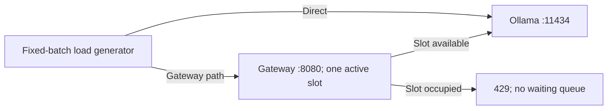

# Day 4 PoC: Direct Ollama versus gateway admission control

## Customer question and decision

Does adding the gateway improve inference capacity, or change how overload is
handled? The experiment shows an admission-policy tradeoff, not a throughput gain.
If the customer requires every submitted request to receive an answer, immediate
rejection alone does not meet that requirement. The next experiment should evaluate
a bounded waiting queue with a maximum wait, rather than an unlimited queue.
A queue cannot increase model capacity or guarantee success during backend failures.

## Environment and provenance

The project owner executed the experiments on 2026-11-12 UTC. Environment snapshots
record Apple M1 Pro, 16 GiB RAM, macOS 27.0.1 arm64, Python 3.12.15 and Ollama
0.40.13. The model is `llama3.2:1b`, Q8_0, digest
`baf6a787fdffd633537aa2eb51cfd54cb93ff08e28040095462bb63daf552878`.
Effective `OLLAMA_NUM_PARALLEL` is unknown. Client concurrency is not evidence of
server execution parallelism. No NVIDIA hardware or cloud resources were used.

The operator started the gateway with `--max-inflight 1 --timeout 60` and upstream
`http://127.0.0.1:11434`. These are operator-command settings, not an independently
queried runtime configuration. Client socket timeout was 65 seconds. The gateway
upstream deadline and the client's per-socket-operation timeout are different.

## Methodology

- Identical prompt: `Explain Kubernetes readiness probes in three sentences.`
- Non-streaming generation: temperature 0, seed 42, num_predict 128, num_ctx 4096,
  keep_alive 10m. Successful measured responses generated 116 output tokens each.
- Each client concurrency configuration used 12 requests per batch, repeated three
  times, with an excluded warmup before each batch. Retries were disabled.
- Completed runs: direct c1, gateway c1, direct c2/c4, gateway c2/c4, in that order.
  The c2/c4 experiment rotates configuration order across repetitions.
- Closed-loop workers immediately submit another request when one finishes. This
  is neither a fixed-arrival-rate experiment nor a sustained-capacity test.
- Client latency includes the HTTP operation; Ollama's internal timings are retained
  separately in the raw responses. Executor queue wait is excluded from request latency.



## Verified results

Pooled statistics combine the three repetitions. RPS and aggregate output tokens/s
use total successful requests/tokens divided by summed batch wall durations, excluding
warmups and gaps. They do not average per-run RPS or include rejected requests as
successful throughput. P50/P95 use successful requests only.

| Route | Client concurrency | Success/attempts | HTTP 429 | P50 ms | P95 ms | Success RPS | Output tokens/s |
|---|---:|---:|---:|---:|---|---:|---:|
| direct | 1 | 36/36 | 0 | 1117.6 | 1233.0 | 0.879 | 102.0 |
| gateway | 1 | 36/36 | 0 | 1123.8 | 1157.5 | 0.886 | 102.8 |
| direct | 2 | 36/36 | 0 | 2298.8 | 2355.6 | 0.872 | 101.2 |
| gateway | 2 | 3/36 | 33 | 1114.9 | Not meaningful (n=3) | 0.895 | 103.8 |
| direct | 4 | 36/36 | 0 | 4497.6 | 4682.2 | 0.878 | 101.8 |
| gateway | 4 | 3/36 | 33 | 1139.3 | Not meaningful (n=3) | 0.872 | 101.1 |

All 66 failed measurement requests in the completed runs were HTTP 429; no other
measurement failures occurred. Gateway c2 and c4 each rejected 91.7% of attempts.
Each overloaded gateway batch had only one successful request, so its printed
P50 and P95 are the same single observation. Pooled successful samples number only
three per overloaded configuration; they cannot support tail-latency conclusions.

## Interpretation and limits

1. Direct c1/c2/c4 throughput remained approximately 0.87–0.88 RPS while median
   latency rose from about 1.12 to 2.30 to 4.50 seconds. Increasing client concurrency
   did not produce a corresponding throughput increase under this workload. This
   does not prove a particular internal queuing mechanism or bottleneck.
2. At c1, both routes completed 36/36 requests with similar observed throughput.
   Sequential execution, thermal/load variation and prompt caching prevent causal
   attribution of small differences to gateway overhead. Model digest and equal
   output counts control some variables, not all variables.
3. Under gateway overload, fast rejections let workers consume the remaining batch
   before the accepted request completed. The load generator therefore changes the
   offered arrival pattern in response to fast failures. Direct and gateway runs
   did not perform equal successful work or run for equal durations.
4. Successful requests remained around 1.1 seconds, but 91.7% of attempts did not
   receive an answer. This cannot be reported as an overall latency improvement.
5. Twelve samples per batch are insufficient for reliable tail estimates. Neither
   these small batches nor the three successful gateway samples establish an SLO,
   sustainable arrival rate, production capacity or general reliability guarantee.
6. Repeated prompts can benefit from caching. Answer correctness is a separate
   evaluation; a completed response is not proof of a correct Kubernetes explanation.

## Excluded setup failure

Run `20261112T141441Z-concurrency-212a360f` aborted at warmup because the gateway
had been stopped with Ctrl+C. The connection-refused evidence is preserved but
excluded from completed-run performance statistics. The replacement gateway c1
run completed after restarting the gateway in a separate terminal.

## Reproduce and reanalyze

Start Ollama with the installed model. Keep this gateway running in a separate terminal:

```bash
.venv/bin/python -m gateway --upstream http://127.0.0.1:11434 --max-inflight 1 --timeout 60
```

From the repository root, run these sequentially; do not run competing model traffic:

```bash
.venv/bin/python labs/01-ollama/concurrency.py --base-url http://127.0.0.1:11434 --requests 12 --concurrency 1 --repeats 3 --timeout 65 --output-dir labs/01-ollama/results/runs/day4-direct
.venv/bin/python labs/01-ollama/concurrency.py --base-url http://127.0.0.1:8080 --requests 12 --concurrency 1 --repeats 3 --timeout 65 --output-dir labs/01-ollama/results/runs/day4-gateway
.venv/bin/python labs/01-ollama/concurrency.py --base-url http://127.0.0.1:11434 --requests 12 --concurrency 2 4 --repeats 3 --timeout 65 --output-dir labs/01-ollama/results/runs/day4-direct-load
.venv/bin/python labs/01-ollama/concurrency.py --base-url http://127.0.0.1:8080 --requests 12 --concurrency 2 4 --repeats 3 --timeout 65 --output-dir labs/01-ollama/results/runs/day4-gateway-load
```

Model and generation defaults are listed above. New runs get unique directories.
The final command can exit 1 with `completed_with_errors` when 429s are recorded;
inspect raw status codes rather than treating every failure as a backend outage.

```bash
# Offline: verify hashes, revalidate raw summaries, separate 429 from other failures.
.venv/bin/python labs/02-gateway/compare.py
make check PYTHON=.venv/bin/python
```

[`compare.py`](../compare.py) reuses the existing benchmark reanalysis validator,
then separates measurement HTTP statuses. It does not rerun inference or rewrite
raw measurements. Its fixed default input is the curated Day 4 evidence directory;
an optional path argument can select another directory with the same manifest format.

The [evidence manifest](../results/verified/day4-20261112/manifest.json) lists original
paths, inclusion decisions and SHA-256 hashes. Raw responses, timing samples,
environment snapshots and summaries are copied byte-for-byte, including the aborted
run. [Comparison JSON](../results/verified/day4-20261112/comparison.json) retains all
computed values, including low-sample percentiles that are deliberately not promoted
as meaningful P95 findings in this report.

## Next experiment

Agree on the acceptable wait, rejection rate and deadline before choosing policy.
Compare immediate rejection with a bounded queue, recording queue wait separately
from upstream execution and client end-to-end time. Use controlled arrival rates
and a longer duration, alternating route order, to reduce the fast-rejection batch
artifact. Test queue-full, wait-expiry, cancellation and failure recovery. These are
proposed improvements; no queue was implemented during Day 4.
